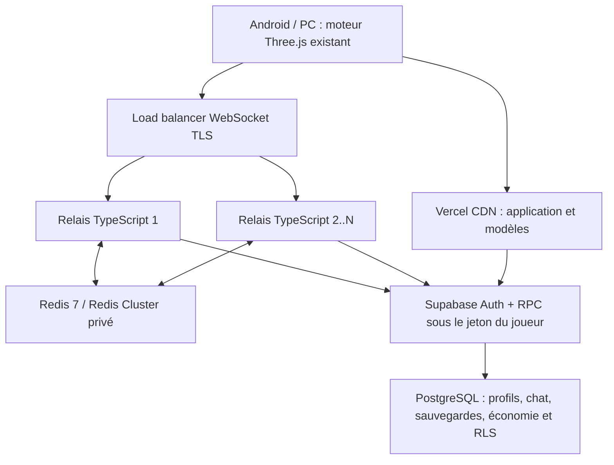

# Capacité réseau de FaîtiereHub / HarooLife — 18 octobre 2026

## Ce qui est livré et ce qui reste à qualifier

L'objectif est **500 000 sessions simultanées**, réparties en instances de ville. Il ne s'agit
pas de dessiner 500 000 personnages sur le même téléphone. La capacité de production à ce
niveau **n'est pas démontrée**. Aucune absence totale de bug ou de ralentissement ne peut être
garantie. Les mesures locales ci-dessous valident une amélioration et un palier de 2 000
connexions, pas un engagement de capacité à 500 000.

Le moteur Three.js, React/Next.js, les parcours FaîtiereHub, les collisions et l'économie du jeu
sont conservés. Aucun service payant n'a été provisionné ni configuration de production Redis
modifiée pour ce travail. Aucune migration SQL n'est nécessaire. Le nouveau mode distribué
nécessite une configuration Railway/Redis explicite ; un push GitHub ne crée pas ces ressources.

## Audit des limites

| Partie | Limite constatée | Correction ou état |
|---|---|---|
| Déplacements | Chaque pose diffusée à toute la ville ; coût quadratique dans une foule | Instances de 96 connexions, secteurs de 24 cases, neuf secteurs observés ; positions proches regroupées |
| Téléphone | Tous les salons publics étaient ouverts en permanence | Salons publics diffusés à l'ouverture ; indicateurs non lus groupés ; DMs/organisations restent actifs |
| Plusieurs relais | Présence en mémoire locale ; aucun bus entre instances | Redis 7, Socket.IO sharded adapter pour les messages et bus sharded de positions |
| Privé | `fetchSockets()` retournait des copies de `socket.data`, dont la modification ne change pas le serveur propriétaire | Attribution/révocation via `socketsJoin/Leave`, autorisation DM depuis l'appartenance effective ; SQL/RLS toujours décisifs |
| Charge DB/Auth | Un client SDK par jeton, sans limite globale des requêtes du relais | Un adaptateur HTTP, jeton par requête, 64 requêtes maximum simultanément par relais, délai de 8 s |
| Connexions | Pas d'admission ni de drainage | Plafonds configurables, 32 authentifications simultanées, `/ready`, arrêt progressif et reconnexions décalées |
| Sécurité WebSocket | CORS seul ne vérifie pas l'Origin des upgrades | Contrôle réel des origines, validation des messages, taille 16 Kio, contrôle de fréquence/expiration |
| Rafraîchissements HTTP | Lecture du monde chaque minute sur tous les appareils | 5 min lorsque le relais est en ligne, 1 min sinon ; gigue, aucune requête superposée |
| Sauvegardes | Tous les appareils écrivent au même rythme | Étalement 12–18 s, sans supprimer la sauvegarde immédiate ; débit SQL à qualifier avant forte croissance |
| Joueurs éloignés | Les douze places d'avatars pouvaient rester occupées par des acteurs périmés | Libération des avatars, véhicules, étiquettes et modes après l'absence de nouvelles poses |
| Modèles 3D | Cache public CDN déjà présent | Conservé ; pas d'authentification sur chaque GLB via middleware |

Le middleware Next.js appelle toujours `getUser()` pour les requêtes auxquelles il s'applique.
Le commentaire historique qui évoque un cache cookie ne démontre pas l'absence d'appel Auth.
Les autorisations serveur continuent à lire `profiles`, jamais les rôles des métadonnées JWT.
Les vérifications QR et les réponses privées restent `no-store`.

## Architecture implémentée



Les WebSockets sont hébergés dans des processus persistants, séparés des fonctions Vercel.
Pas de connexion SQL maintenue par joueur. Les positions ne sont jamais écrites dans Postgres.
Redis contient uniquement des identifiants de session éphémères et des informations publiques
(nom de jeu, clé opaque, tenue, localité). Ni jeton, ni numéro de téléphone, ni portefeuille.

L'affectation d'une instance est atomique et décidée par le serveur. Une réservation compte
une connexion, donc deux onglets consomment deux places mais ne doublent pas le nom affiché.
Les six localités existantes restent accessibles. Le compteur visible désigne les joueurs
**à proximité dans l'instance**, pas le total de toute la ville ou de toute la plateforme.
Les invitations et DMs restent globaux via SQL et les rooms utilisateur ; une invitation
actuelle ne réserve pas une place dans la même instance pleine. Une réservation de groupe
et un passage volontaire entre instances constituent une étape produit distincte.

Chaque connexion dispose au plus de neuf secteurs de réception. Les abonnements Redis sont
mutualisés par secteur et par processus. Les poses sont regroupées sur 50 ms côté bus et côté
connexion ; un paquet contient au plus 24 voisins triés par distance. Le moteur garde son
plafond de douze avatars affichés. Les mouvements restent hors du state React. Les positions
volatiles peuvent être remplacées sous pression ; elles ne forment jamais une file de
rattrapage illimitée. La file locale par observateur est bornée à 96 clés.

Un bail dure 45 s et est renouvelé toutes les 15 s, selon l'heure Redis. Les scripts récupèrent
les places expirées sans `KEYS` ni balayage intégral. Un seul relais publie l'état changé d'une
instance par fenêtre de rafraîchissement ; une réconciliation périodique corrige un départ
perdu. Après un crash, la visibilité peut prendre environ 45–60 s pour se réconcilier : ce
n'est pas une présence instantanément exacte. Les clés éphémères cessent aussi de persister
après l'arrêt total du service (TTL des états et index).

Une erreur temporaire de la base déclenche aussi une reprise automatique de la boîte
d’envoi, avec délai croissant et le même identifiant client ; aucune reconnexion manuelle
n’est nécessaire pour relancer un message en attente.

Le chat reste enregistré **avant** diffusion, avec identifiant client idempotent, curseurs de
reprise et RLS. Le budget Redis limite le salon Togo à 5 messages/s et chaque autre salon à
20 messages/s pour l'ensemble des relais. Ce sont des plafonds de flux collectif, en plus des
limites individuelles ; l'interface invite à réessayer. Les messages publics restent consultables
dans l'historique ; seuls leurs abonnements permanents de corps de messages sont retirés du téléphone fermé. Les badges non lus restent
actifs via des notifications compactes, regroupées au plus une fois par seconde et par salon
public pour tous les relais ; elles ne contiennent ni texte de message ni coordonnées.
Le chargement initial des historiques privés est borné aux 30 derniers salons ; les autres
restent accessibles à l'ouverture. Les anciens clients du protocole v1 conservent leur chemin
non groupé pour permettre un déploiement progressif ; tous les clients devront être actualisés
avant de qualifier une très grande charge.

## Mesures reproductibles

Machine partagée de développement : Linux, Node 24, 5 CPU logiques visibles. Relais et générateur
sont des **processus séparés sur la même machine**. Redis local 7.4.8. Authentification synthétique
HMAC dans un fichier de test qui n'est jamais importé par `realtime/main.ts`. Le banc refuse les
cibles réseau externes. Aucun appel à une base ou à un compte de production pendant la charge.
Les tests d'intégration distincts utilisent de vraies migrations PostgreSQL dans PGlite/RLS.

| Scénario | Connexions | Relais | Poses reçues par pose émise | Latence d'acheminement p95 |
|---|---:|---:|---:|---:|
| Ancien serveur `228f4e6b`, ville entière | 200 | 1 | 181,31 | 15 ms |
| Optimisation finale, secteurs + instances + paquets groupés | 200 | 1 | 20,03 | 50 ms |
| Bus Redis + paquets groupés, essai final | 2 000 | 2 | 20,26 | 105 ms |

La diminution à 200 joueurs est de **89 % des copies de poses** pour ce placement de
joueurs. Le regroupement ajoute volontairement jusqu’à 50 ms côté connexion : le p95 local
passe de 15 à 50 ms, en échange d’un flux borné et d’une réception plus régulière en foule. Elle vient du filtrage spatial et des instances ; elle ne représente pas un pourcentage
d'amélioration du FPS. Ne pas comparer les 105 ms avec les 50 ms comme si les charges étaient
identiques : le dernier essai comporte dix fois plus de joueurs et un bus partagé.

Sur l'essai groupé à 2 000 : 30,45 s de mesure, 302 000 poses émises, 6 119 506 positions reçues,
2 000 connexions encore établies, zéro erreur de connexion et zéro déconnexion. Pic RSS observé
**395,9 Mio par relais**, p95 de boucle événementielle maximale observée **44,37 ms**. Le générateur
lui-même atteint 48,23 ms de p95 de boucle ; ces chiffres ne mesurent pas la 3G togolaise, le
FPS Android ou une capacité réseau sur Internet. Les histogrammes ont des tranches de 5 ms et
un plafond explicite de 5 s. Les poses volatiles ne sont pas un transport de livraison garantie.

Les JSON bruts sont dans `docs/captures/realtime-capacity/` (`after-200-initial.json` conserve
l’essai intermédiaire antérieur au regroupement final). Le budget `maxConnections=5000`
est un **plafond d'admission**, pas une capacité certifiée par cette mesure. La mémoire et le
CPU du générateur, de Redis, du système et de TLS ne sont pas compris dans le RSS d'un relais.

```bash
# Redis 7+ local, dédié aux tests ; aucun secret de production.
HAROOLIFE_TEST_REDIS_URL=redis://127.0.0.1:6379 npm run test:realtime:cluster
npm run test:realtime:load -- --clients 2000 --seconds 30 --nodes 2 \
  --redis-url redis://127.0.0.1:6379 --output /tmp/realtime-2000.json
# Optionnel : test réel de trois masters Redis Cluster déjà démarrés.
HAROOLIFE_TEST_REDIS_CLUSTER_URLS=redis://127.0.0.1:16400,redis://127.0.0.1:16401,redis://127.0.0.1:16402 \
  node --import tsx --test tests/haroolife-redis-cluster.test.ts
```

Le fixture du banc utilise des comptes fictifs et exclut volontairement les écritures SQL.
Il ne faut pas le déployer comme un serveur de jeu. La CI dédiée démarre deux vrais relais,
un Redis 7 et les migrations SQL ; la qualification de Redis Cluster à trois masters a aussi
été exécutée localement. Le test à trois masters ne simule pas une réplication ni un failover.

## Validation fonctionnelle

Les contrôles de type, de sécurité statique, le build Next.js et celui du relais passent.
La suite comporte 442 tests unitaires/SQL, dont 4 tests du vrai client (voyage rapide entre
villes, badges sans corps de messages et blocage, arrêt pendant une lecture de jeton,
reprise automatique d’un message après surcharge temporaire). Les 34 tests de durcissement passent. Les 4 tests Redis
entre deux relais et le test sur trois masters passent également.

Après fusion de `31fb956d`, six scénarios navigateur passent : avatars/taxi/moto distants et
libération des acteurs périmés sur desktop et profil Android ; discussion entre deux joueurs
avec coupure réseau et rechargement ; conversation entre le tableau de bord et le jeu ;
transfert d'argent sans doublon ; reprise de sauvegarde sur un autre appareil avec plafond
du portefeuille. Quatre doublons de projets mobiles sont exclus explicitement car ces scénarios
ouvrent déjà leurs propres contextes. La suite complète de tous les parcours du jeu n'a pas
été relancée dans ce chantier réseau.

```bash
HAROOLIFE_TEST_PORT=3225 HAROOLIFE_SUPABASE_PORT=54385 PW_CHROMIUM_PATH=/usr/bin/chromium \
  npx playwright test --config=e2e/lome-realtime-local.config.ts \
  -g 'real relay|two people chat|a private message is seen|game money sent|the game follows'
```

## Activation concrète dans Railway

1. Créer un Redis **7+** privé, politique `noeviction`, surveillance mémoire et haute disponibilité
   selon le palier visé. Upstash REST pour les limites HTTP existantes n'est pas le protocole
   natif de ce bus. En dehors d'un réseau privé, imposer TLS avec `rediss://`.
2. Dans le service relais, configurer `HAROOLIFE_REDIS_URL` ou les seeds
   `HAROOLIFE_REDIS_CLUSTER_URLS`, puis `HAROOLIFE_REALTIME_DISTRIBUTED=true`.
   Toutes les répliques de production doivent partager `HAROOLIFE_REALTIME_POOL=haroolife`.
   Des pools indépendants ne partagent pas la diffusion des DMs ; ce paramètre sépare les
   environnements, il ne constitue pas un routage multi-pool prêt à l'emploi.
3. Conserver les URL Supabase, clé **anon**, origines autorisées et URL publique du relais.
   Ne jamais installer de clé `service_role` dans ce service. Conserver l'URL publique actuelle
   évite de changer la CSP et la configuration client. Aucune clé Redis dans `NEXT_PUBLIC_*`.
4. Choisir comme config Railway `/ops/haroolife-realtime/railway.toml`, racine du service `/`.
   Le fichier prévoit deux répliques, `/ready` et un drainage de 30 s. Il ne s'active pas
   automatiquement dans le service actuel. Les options ont été confrontées au schéma officiel.
5. Commencer avec des plafonds prudents mesurés en staging, vérifier les communications entre
   deux comptes reliés à des processus différents, puis augmenter les répliques. Le mode
   distribué refuse de démarrer sans configuration Redis ; une panne ne bascule pas
   silencieusement vers deux villes locales isolées.
6. Garder `HAROOLIFE_REALTIME_AUTH_MODE=user` au départ. `claims` utilise la signature vérifiée
   par Supabase et les JWKS cachées si le projet a des clés asymétriques. HS256 continue de
   contacter Auth. Activer `claims` seulement après vérification des clés et de la politique
   de révocation : un JWT signé peut rester valable jusqu'à son expiration. `chat_me`/RLS
   continuent à décider les droits et les requêtes durables utilisent le jeton du joueur.

`/health` expose les compteurs bornés, la mémoire et la boucle événementielle ; `/ready` renvoie
503 pendant le drainage ou une indisponibilité Redis. SIGTERM retire d'abord la réplique du
load balancer, puis ferme ses sessions. Les retries du client sont étalés et le jeton est
relisé à la reconnexion. Conserver une marge de capacité pour absorber les reconnexions après
la perte d'une réplique. Le rollback se fait en redéployant le commit précédent **avec une
seule réplique**, car l'ancien serveur ne partage pas la présence.

## Dimensionner réellement 500 000 connexions

La proportion de joueurs actifs change totalement le coût. Il faut convenir d'un scénario :
500 000 connexions presque au repos, 100 000 joueurs actifs, ou 500 000 qui bougent et écrivent
constamment. Le serveur ne rend pas la 3D : le FPS dépend aussi du téléphone, du GPU et de la
connexion de chaque joueur.

| Charge si tous jouent | Ordre de grandeur arithmétique, pas un benchmark |
|---|---:|
| Poses à 5 Hz | 2 500 000 mises à jour/s en entrée |
| Diffusion dense, 24 voisins à chaque mise à jour | Jusqu'à 60 000 000 positions destinataires/s avant coalescence |
| Sauvegarde d'une partie modifiée toutes les 15 s | Environ 33 333 écritures/s |
| Lecture du monde toutes les 5 min | Environ 1 667 requêtes/s, avant reprises et navigations |

Ces écritures et les autres RPC (argent, invitations, panneaux, messagerie, authentification)
restent un **point de qualification obligatoire** pour Supabase. Décaler des requêtes réduit
les pics mais ne supprime pas leur volume moyen. Le stockage des sauvegardes, les index,
les verrous du portefeuille et le rôle des autres services doivent être profilés ; augmenter
les répliques WebSocket sans dimensionner PostgreSQL ne résout pas ce problème.

Le calcul de parc doit utiliser `répliques >= plafond(N / capacité_testée_par_réplique / 0,7)`
et une qualification CPU/mémoire/réseau, pas simplement `N / maxConnections`. Avec 1 000
connexions réellement mesurées par processus, cela ferait déjà 715 répliques à 70 % de charge,
sans prouver qu'il s'agit du bon dimensionnement. Il faut mesurer chaque type de machine,
une densité forte dans le même quartier, des positions dispersées et les accès métier.

Avant d'annoncer 500 000 en production :

- Vercel/CDN : quotas de bande passante, origines et cache des modèles, tests d'arrivée froide ;
- relais : load balancer WebSocket TLS, autoscaling sur connexions/CPU/lag, limites de fichiers,
  réserve de reconnexion et déploiements progressifs ;
- Redis : cluster répliqué, débit de publication, nombre d'abonnements, latence Lua et failover ;
  les réservations d'une localité partagent un hash slot pour l'atomicité, à profiler en ville dense ;
- Supabase : plan et compute adaptés, pools de connexions, capacité Auth/PostgREST, requêtes/index
  réellement profilés, sauvegardes/restauration, isolation de capacité vis-à-vis du SaaS agricole ;
- tests distribués par paliers 5k → 10k → 50k → 100k → 250k → 500k, puis tenue 2 h, rafales de
  reconnexion, perte d'un relais, bascule Redis, latence DB, téléphone 3G et Android physique ;
- critères convenus : p95/p99, taux d'erreurs, coût de trafic, absence de doubles paiements ou
  transferts, cohérence des sauvegardes et retour arrière réussi. Les tests de production
  nécessitent un budget et des générateurs distribués, pas une boucle sur ce poste de travail.

Le langage TypeScript n'est pas remplacé : la diffusion, les accès aux données et le budget
réseau étaient les premiers verrous. Un gateway Go ou Rust ne se justifie qu'après un profil
montrant que le CPU du relais reste le facteur limitant, et peut être introduit derrière le
même protocole sans réécrire l'application ou le moteur du joueur.
